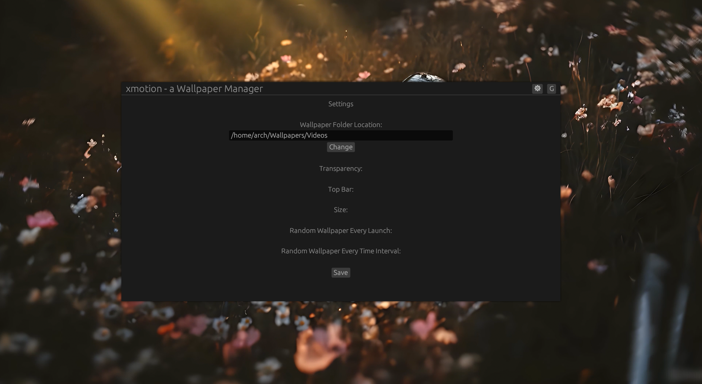

# xmotion
A sleek, lightweight X11 system tray utility that manages live video wallpapers using xwinwrap and mpv. Built for tiling window managers like i3, bspwm, and dwm

### Settings

## Credits & Acknowledgments

`xmotion` is standing on the shoulders of giants. This utility would not be possible without the incredible work done by the open-source multimedia and windowing communities:

- **[xwinwrap](https://github.com)** - The brilliant X11 utility that enables sticking any player window directly to the desktop root layer.
- **[mpv player](https://mpv.io)** - The legendary, highly customizable media player that delivers smooth, hardware-accelerated video rendering.

